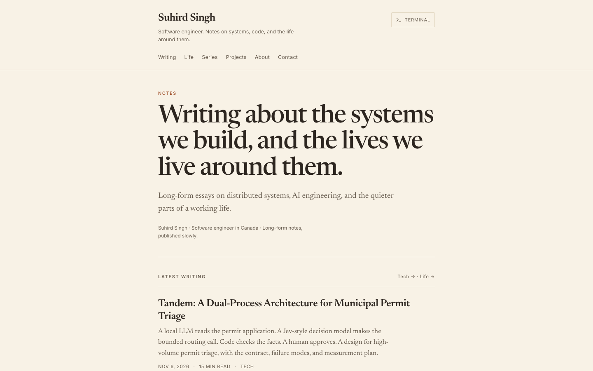
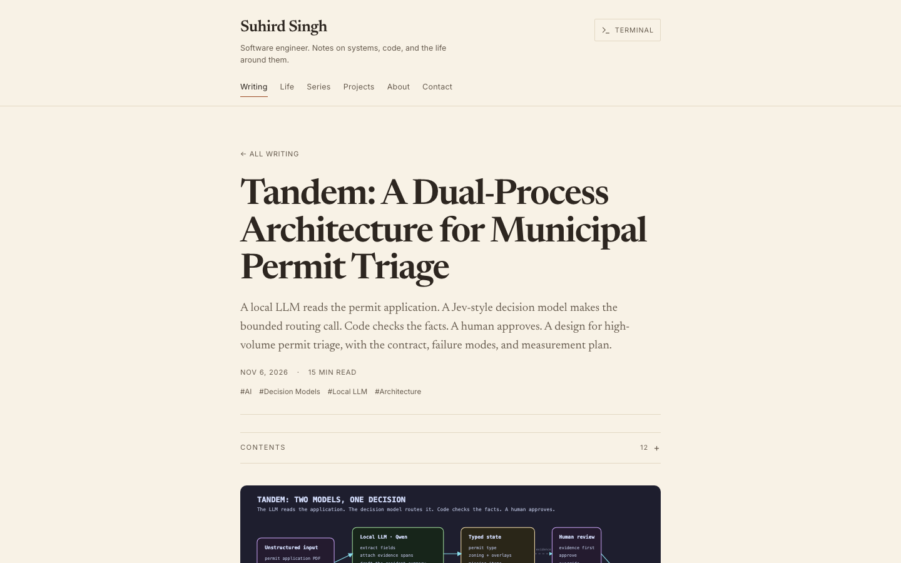

### My Personal Blog

Check it out at: [suhird.me](https://suhird.me)

### Two ways to read

The site has two skins, switched by the **Reading / Terminal** button in the header:

- **Terminal** — the default Catppuccin Mocha skin: terminal window chrome, monospace
  type, dashboard home, and the original motion.
- **Reader** — a warm-paper, book-like layout: Newsreader serif body at a ~66ch
  measure, quiet Inter UI, JetBrains Mono for code, no terminal chrome, and no
  animation. It is designed to read like a Kindle page on a phone.

The choice is saved in `localStorage` under `site-mode` and applied before first
paint by a small script in `index.html`. `?skin=reader` / `?skin=terminal` opens a
page in a specific skin without saving the choice (useful for sharing and QA).

Design notes and the implementation plan live in
[`docs/reading-mode-plan.md`](docs/reading-mode-plan.md). Reader tokens and global
overrides live in [`src/styles/reader.css`](src/styles/reader.css); the Catppuccin
terminal tokens remain in [`src/index.css`](src/index.css).

### Reader preview

