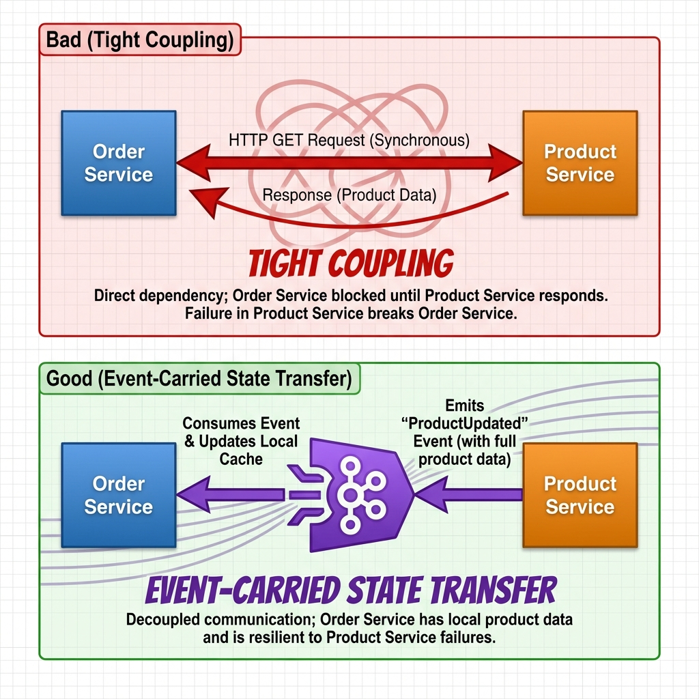
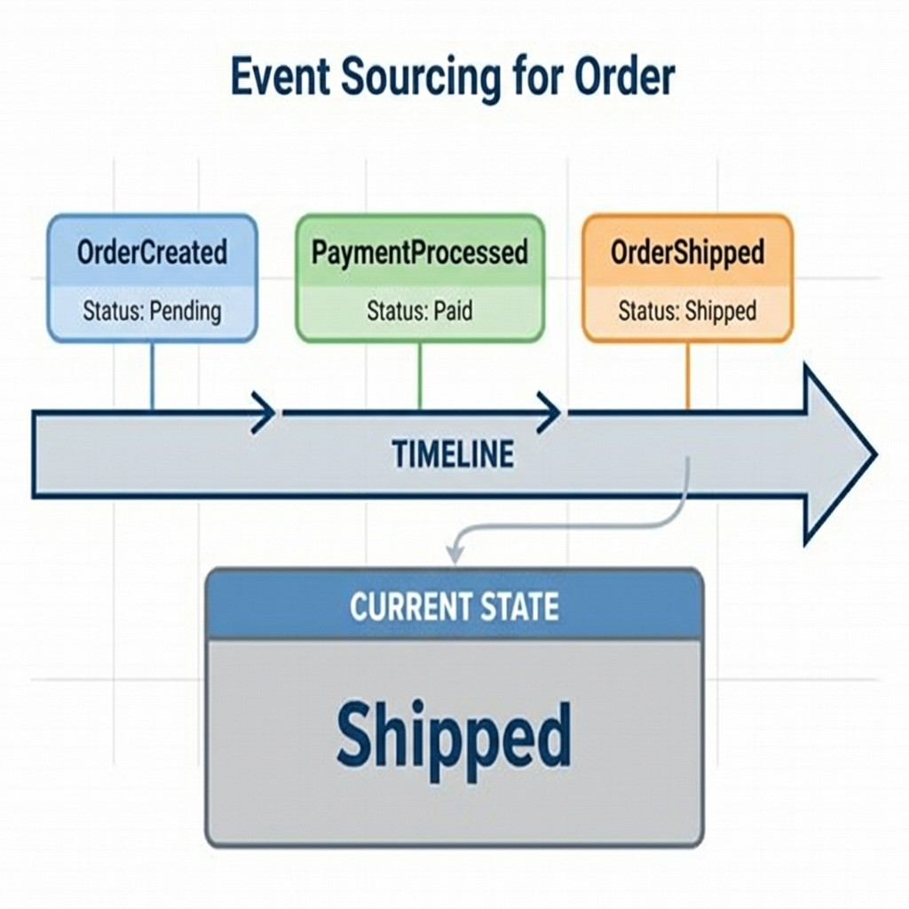

# Event-Driven Patterns in Kafka

I used these patterns on a checkout flow that started as synchronous REST calls between four services. The call graph worked in staging and fell apart under load. Moving the side effects to events fixed the coupling, but it introduced a different set of problems around ordering, replay, and state.

## Introduction

When Service A calls Service B synchronously, the two are coupled in time. If Service B is slow, Service A waits. If Service B is down, the request fails even when the work could have been done later.

An event-driven architecture changes the interaction. Instead of asking for data or issuing a command, a service writes an event: *something happened*. Other services read it and react on their own schedule.

Kafka is a common backbone for this because it keeps a durable, replayable log. I use a fictional shop, ShopStream, to show the patterns I have used in production.

## The Case Study: ShopStream

**ShopStream** is a high-volume online retailer. We need to handle:
1.  **Orders**: Users place orders.
2.  **Inventory**: We must ensure items are in stock.
3.  **Shipping**: We need to dispatch goods.
4.  **Notifications**: Users need emails/SMS updates.

The order flow looked like this.

---

## Pattern 1: Event Notification

The detailed information about the event isn't necessarily in the event itself. The event is primarily a "ping" to wake up other services.

### The Scenario
When a user places an order, we want to:
*   Email the user.
*   Notify the warehouse to pack items.

### The Problem with Sync
If the Order Service calls the Email Service and Warehouse Service sequentially:
1.  Latency increases (sum of all calls).
2.  If the Email Service is down, does the Order fail?

### The Kafka Solution
The **Order Service** publishes an `OrderPlaced` event.

*   **Topic**: `orders`
*   **Key**: `order_id`
*   **Payload**: `{ "orderId": "123", "userId": "456", "timestamp": "..." }`

The **Notification Service** and **Warehouse Service** subscribe to the `orders` topic. They react independently. If the Notification Service is down, it catches up later. The Order Service is fast and decoupled.

---

## Pattern 2: Event-Carried State Transfer

This pattern addresses the problem of data ownership and querying across boundaries.

### The Problem
The **Order Service** needs to know the price and description of products to validate an order.
**Bad Approach**: The Order Service makes a synchronous GET request to the **Product Service** for every item in the cart.
*   **Result**: The Product Service gets hammered. The Order Service is coupled to the Product Service's uptime.

### The Solution
The **Product Service** emits a `ProductUpdated` event whenever a product changes. Crucially, this event contains the **full state** of the product (price, description, weight).

*   **Topic**: `products`
*   **Payload**: `{ "id": "p1", "price": 19.99, "name": "Super Widget", ... }`

The **Order Service** consumes these events and maintains a local read-only cache (e.g., in a local database or key-value store). When an order comes in, it checks its *local* data.
*   **Benefit**: Zero latency on validation. No runtime dependency on the Product Service.

---

## Pattern 3: Event Sourcing

Instead of storing just the *current* state of an entity, we store the *sequence of events* that led to that state.

### The Concept
For an Order, we don't just UPDATE a row in a SQL table from 'Pending' to 'Shipped'. We record:
1.  `OrderCreated`
2.  `PaymentProcessed`
3.  `InventoryReserved`
4.  `OrderShipped`

### Why?
*   **Auditability**: You know exactly *when* and *why* the state changed.
*   **Debugging**: You can replay the events to see exactly what happened in the past.
*   **Flexibility**: You can project these events into different views. One view might calculate "Current Order Status", another might calculate "Average time from Payment to Shipping".

In Kafka, the topic *is* the source of truth.

---

## Pattern 4: CQRS (Command Query Responsibility Segregation)

CQRS is often the natural companion to Event Sourcing. It splits your application into two parts:
1.  **Command Side (Write)**: Validates commands and emits events. (e.g., "Place Order"). Optimized for business logic.
2.  **Query Side (Read)**: Consumes events and builds "Materialized Views" optimized for reading. (e.g., "Get My Order History").

With Kafka, you can have a high-performance ElasticSearch consumer building a search index, and a Redis consumer building a key-value look-up, both driven by the same event stream.

---

## Conclusion

Switching to an Event-Driven Architecture with Kafka requires a mindset shift. You move from asking "What is the state now?" to asking "What happened?".

By leveraging patterns like **Event Notification**, **Event-Carried State Transfer**, and **Event Sourcing**, you can build systems that are resilient, scalable, and easy to extend.

*Happy key-structuring!*
